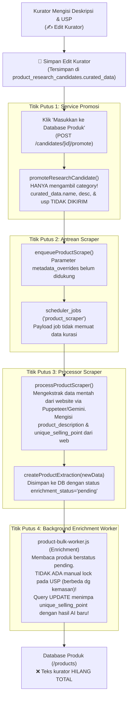
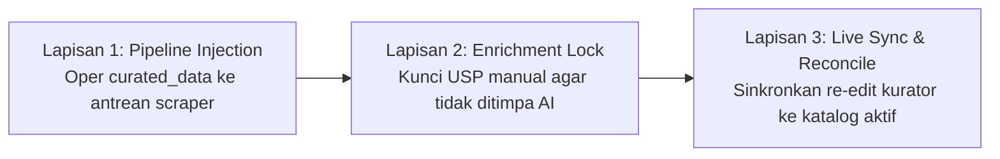

# Usulan Perbaikan: Sinkronisasi Deskripsi dan USP Hasil Kurasi Radar Produk ke Database Produk

**Tanggal**: 20 November 2026  
**Status**: Usulan & Analisa Masalah (Menunggu Persetujuan Implementasi)  
**Terkait Menu**: Radar Produk (`/product-radar`) dan Database Produk (`/products`)  
**Penulis**: Antigravity  

---

## 1. Ringkasan Eksekutif

Pada menu **Radar Produk** (`/product-radar`), kurator dapat meninjau kandidat riset dari TeleRadar melalui drawer/modal detail kandidat. Pada seksi **✍️ Edit Kurator**, kurator dapat memasukkan teks yang sudah disempurnakan:
1. **Nama Kurasi** (`curated_data.name`)
2. **Deskripsi Kurasi** (`curated_data.description`)
3. **USP Kurasi** (`curated_data.usp`)
4. **URL Kurasi** (`curated_data.target_url`)

Kurator kemudian menekan tombol **💾 Simpan Edit Kurator** (berhasil tersimpan ke tabel `product_research_candidates.curated_data` dengan penambahan nomor revisi).

Namun, saat produk tersebut dimasukkan ke **Database Produk** (baik melalui tombol **Masukkan ke Database Produk** satuan maupun **Bulk Approval**), deskripsi dan USP hasil kurasi tersebut **tidak terbawa** ke katalog `product_extractions`. Di menu Database Produk (`/products`), produk yang baru masuk justru menampilkan deskripsi mentah dari halaman web hasil scraping dan USP baru yang di-generate ulang oleh AI worker, atau kosong.

Dokumen ini membedah akar penyebab masalah secara menyeluruh di seluruh rantai kode (end-to-end), serta menyusun rencana perbaikan terstruktur dengan 3 lapisan proteksi.

---

## 2. Analisis Rantai Masalah (Root Cause Analysis)

Setelah penelusuran kode secara menyeluruh, ditemukan bahwa hilangnya deskripsi dan USP terjadi karena **terputusnya jembatan data kurasi pada 4 titik berbeda di pipeline**:



### Rincian 4 Titik Putus di Kode:

#### Titik Putus 1: `lib/product-research-promotion-service.js` (Baris 150–160)
Saat mempromosikan kandidat, fungsi `promoteResearchCandidate()` mengambil `targetCategory` dari `candidate.curated_data`, tetapi mengabaikan `name`, `description`, dan `usp`:
```javascript
// KODE SAAT INI (lib/product-research-promotion-service.js):
const enqueueFn = deps.enqueueProductScrapeFn || enqueueProductScrape;
const targetCategory = candidate.curated_data?.category || candidate.research_data?.category || '';

const enqueueResult = await enqueueFn({
  urls: [effectiveUrl],
  category: targetCategory,
  repair_mode: false,
  refresh_photo: false,
  reserved_ids: { [effectiveUrl]: claim.reservedProductId }
  // ⚠️ MASALAH: candidate.curated_data.name, description, dan usp TIDAK DIOPER!
}, deps);
```

#### Titik Putus 2: `lib/product-catalog-service.js` (Baris 235–243 & 408–424)
Fungsi `enqueueProductScrape` dan pembuatan job `product_scraper` di `scheduler_jobs` belum memiliki parameter untuk meneruskan metadata kurator:
```javascript
// KODE SAAT INI (lib/product-catalog-service.js):
export async function enqueueProductScrape({
  urls,
  csv_data,
  category,
  tags,
  repair_mode = true,
  refresh_photo = false,
  reserved_ids: suppliedReservedIds = null
  // ⚠️ MASALAH: Tidak ada parameter metadata_overrides
} = {}, deps = {})
```

#### Titik Putus 3: `lib/scheduler-processors.js` (Baris 9678–9712 & 9750–9770)
Saat worker `product_scraper` selesai men-scrape halaman produk, ia membuat entitas baru di `product_extractions` murni dari teks mentah website (`scrapedItem.scraped.description`) dan ekstraksi Gemini awal (`finalUsp`):
```javascript
// KODE SAAT INI (lib/scheduler-processors.js):
const data = {
  product_name: productData.product_name || scrapedItem.scraped.title || 'Produk Tanpa Nama',
  product_description: scrapedItem.scraped.description || scrapedItem.scraped.title || '',
  unique_selling_point: finalUsp,
  ...
};
...
await createProductExtraction(newData);
```
Karena tidak mengetahui adanya `curated_data`, nama, deskripsi, dan USP kurasi tidak pernah disuntikkan ke `newData`.

#### Titik Putus 4: `lib/product-bulk-worker.js` (Baris 300–329)
Saat `createProductExtraction()` selesai, kolom `enrichment_status` secara baku bernilai `'pending'`.
Background worker `product-bulk-worker.js` kemudian mengambil produk tersebut untuk melakukan AI Enrichment.
Pada proses enrichment kemasan (`packaging_type`), sistem memiliki fungsi pengaman `isPackagingManualLocked(job)`. Namun untuk `unique_selling_point`, **TIDAK ADA proteksi kunci manual sama sekali**:
```sql
-- KODE SAAT INI (lib/product-bulk-worker.js):
UPDATE product_extractions
SET unique_selling_point = $1, -- ⚠️ AI SELALU MENIMPA USP DENGAN HASIL BARU!
    product_truth = $2,
    geometric_truth = $3,
    ...
WHERE id = $10 AND tenant_id = $11
```
Akibatnya, jikapun ada USP yang tersimpan, worker ini akan langsung menimpanya dengan USP bahasa Indonesia hasil imajinasi baru dari Gemini.

---

### Titik Masalah Tambahan: Re-editing Setelah Masuk Katalog
Skenario penting lainnya:
Jika produk **sudah berada di katalog** (`cf_product_id` sudah ada), lalu kurator membuka kembali drawer Radar Produk, mengubah Deskripsi/USP di **✍️ Edit Kurator**, dan menekan **💾 Simpan Edit Kurator**:
- Endpoint `PATCH /api/v2/product-research/candidates/[id]` memanggil `updateResearchCandidateCuration()` di `lib/product-research-repository.js`.
- Fungsi ini **hanya meng-UPDATE tabel `product_research_candidates`**.
- Tabel `product_extractions` (`WHERE id = existing.cf_product_id`) **sama sekali tidak disentuh**.
- Akibatnya, kurator mengira perubahan sudah tersimpan, tetapi di katalog produk tetap berisi data lama.

---

## 3. Usulan Solusi (3 Lapisan Proteksi)

Untuk menyelesaikan masalah ini secara tuntas, kokoh, dan tahan masa depan, diusulkan arsitektur perbaikan dengan 3 lapisan:



---

### Lapisan 1: Penerusan Metadata Kurasi Melalui Antrean Scraper

1. **`lib/product-research-promotion-service.js` (`promoteResearchCandidate`)**:
   Kumpulkan teks kurasi yang efektif dari kandidat:
   ```javascript
   const curatedName = candidate.curated_data?.name?.trim() || candidate.research_data?.name?.trim() || '';
   const curatedDesc = candidate.curated_data?.description?.trim() || candidate.research_data?.description?.trim() || '';
   const curatedUsp = candidate.curated_data?.usp?.trim() || candidate.research_data?.usp?.trim() || '';

   const metadataOverrides = {
     [effectiveUrl]: {
       product_name: curatedName || undefined,
       product_description: curatedDesc || undefined,
       unique_selling_point: curatedUsp || undefined,
       candidate_id: candidate.id
     }
   };
   ```
   Kirimkan `metadata_overrides: metadataOverrides` ke `enqueueFn()`.

2. **`lib/product-catalog-service.js` (`enqueueProductScrape`)**:
   Terima parameter `metadata_overrides = null` dan masukkan ke payload job `product_scraper`:
   ```javascript
   const created = await createJobFn('product_scraper', {
     tenant_id: activeTenant,
     urls: chunk,
     category,
     tags,
     url_affiliates_map: urlAffiliatesMap,
     repair_mode,
     refresh_photo: Boolean(refresh_photo),
     reserved_ids: reservedIds,
     metadata_overrides: metadata_overrides || undefined
   });
   ```

3. **`lib/scheduler-processors.js` (`processProductScraper`)**:
   Saat mengeksekusi job scraping, periksa apakah URL atau `productId` memiliki `metadata_overrides`:
   ```javascript
   const metaOverride = payload?.metadata_overrides?.[scrapedItem.url] || payload?.metadata_overrides?.[productId];

   const finalName = metaOverride?.product_name || productData.product_name || scrapedItem.scraped.title || 'Produk Tanpa Nama';
   const finalDesc = metaOverride?.product_description || scrapedItem.scraped.description || scrapedItem.scraped.title || '';
   const finalUsp = metaOverride?.unique_selling_point || (typeof productData.usp === 'string' ? productData.usp : JSON.stringify(productData.usp || ''));

   const data = {
     product_name: finalName,
     product_description: finalDesc,
     unique_selling_point: finalUsp,
     ...
     raw_response: JSON.stringify({
       ...productData,
       photo_selection_audit: photoPickerResult?.evaluation || null,
       photo_final_check: finalCheckResult || null,
       studio_polish: studioPolish,
       usp_source: metaOverride?.unique_selling_point ? 'manual' : 'scraper',
       curated_from_radar: Boolean(metaOverride)
     })
   };
   ```

---

### Lapisan 2: Penguncian USP Manual pada Background AI Enrichment Worker

Di `lib/product-bulk-worker.js`, tambahkan proteksi yang setara dengan `isPackagingManualLocked`:

1. **Buat Fungsi `isUspManualLocked(job)`**:
   ```javascript
   export function isUspManualLocked(job) {
     const parsedRaw = parseRawResponseSafe(job?.raw_response);
     if (parsedRaw?.usp_source === 'manual') return true;
     if (parsedRaw?.curated_from_radar && job?.unique_selling_point && String(job.unique_selling_point).trim() !== '') return true;
     return false;
   }
   ```

2. **Kirim USP Kurator ke Prompt Gemini sebagai Konteks Grounding**:
   ```javascript
   const hasManualUsp = isUspManualLocked(job);
   // Masukkan ke buildEnrichmentPrompt agar Gemini menggunakan USP kurator sebagai acuan menyusun Product Truth
   ```

3. **Pertahankan Nilai USP Asli saat UPDATE Database**:
   ```javascript
   const nextUsp = hasManualUsp
     ? job.unique_selling_point
     : JSON.stringify(item.unique_selling_point || []);

   // Jalankan UPDATE dengan nextUsp
   ```
   Dengan cara ini, AI Enrichment tetap menghasilkan `product_truth` (Inggris), `geometric_truth` (Inggris), dan `clean_photo_t2i_prompt` yang akurat, **tanpa merusak teks USP Bahasa Indonesia kurator**.

---

### Lapisan 3: Sinkronisasi Langsung saat Edit Kurator & Rekonsiliasi Status

1. **Sinkronisasi Otomatis pada `updateResearchCandidateCuration()` (`lib/product-research-repository.js`)**:
   Bila kandidat sudah terhubung ke katalog (`existing.cf_product_id` ada), setiap kali kurator menyimpan "Edit Kurator" di Radar, sistem langsung memperbarui baris produk di `product_extractions`:
   ```javascript
   if (existing.cf_product_id) {
     const sets = [];
     const params = [];
     let pIdx = 1;
     if (curatedData?.name?.trim()) {
       sets.push(`product_name = $${pIdx++}`);
       params.push(curatedData.name.trim());
     }
     if (curatedData?.description?.trim()) {
       sets.push(`product_description = $${pIdx++}`);
       params.push(curatedData.description.trim());
     }
     if (curatedData?.usp?.trim()) {
       sets.push(`unique_selling_point = $${pIdx++}`);
       params.push(curatedData.usp.trim());
       sets.push(`raw_response = jsonb_set(COALESCE(raw_response::jsonb, '{}'::jsonb), '{usp_source}', '"manual"')`);
     }
     if (sets.length > 0) {
       sets.push(`updated_at = NOW()`);
       params.push(existing.cf_product_id, tenantId);
       await client.query(
         `UPDATE product_extractions SET ${sets.join(', ')} WHERE id = $${pIdx++} AND tenant_id = $${pIdx++}`,
         params
       );
     }
   }
   ```

2. **Jaring Pengaman Rekonsiliasi pada `getResearchCandidatePromotionStatus()` (`lib/product-research-promotion-service.js`)**:
   Saat status job scraper selesai dan produk katalog terdeteksi, jika katalog produk masih memiliki deskripsi kosong atau USP bawaan sementara kandidat memiliki `curated_data`, lakukan sinkronisasi pemulihan otomatis satu kali.

---

## 4. Matriks Perbandingan Sebelum vs Sesudah

| Aspek / Skenario | Perilaku Saat Ini (Bermasalah) | Perilaku Usulan (Setelah Diperbaiki) |
|---|---|---|
| **Promosi Produk Baru ke Katalog** | Deskripsi dan USP kurator hilang; katalog diisi deskripsi meta website dan USP acak dari Gemini | Deskripsi dan USP kurator langsung masuk sebagai `product_description` dan `unique_selling_point` produk katalog |
| **Siklus Background AI Enrichment** | Gemini secara otomatis menimpa `unique_selling_point` kurator dengan daftar poin baru | USP kurator dikunci (`usp_source: 'manual'`); Gemini hanya memproses Product/Geometric Truth dan prompt foto |
| **Edit Kurator setelah Produk Masuk Katalog** | Hanya tersimpan di tabel riset `product_research_candidates`; tabel katalog tetap lama | Otomatis tersinkronisasi ke `product_extractions`, sehingga katalog langsung ter-update |
| **Kandidat Terduplikat (Sudah Ada di Katalog)** | Dihubungkan tanpa menimpa data produk yang ada | Tetap terlindungi (tidak menimpa data katalog orang lain secara tidak sengaja) |
| **Janji UI Radar Produk** | Janji *"Teks hasil scrape di katalog tidak menimpa edit kurator"* terlanggar | Janji UI terpenuhi 100% dan konsisten |

---

## 5. Rencana Kerja & SOP Pengujian

1. **Pembuatan Branch Fitur**:
   - Sesuai SOP Branch Dev vs Staging: Buat branch baru dari `main`:
     ```bash
     git checkout main && git pull
     git checkout -b fitur/sync-kurasi-radar-ke-produk
     ```
2. **Implementasi File**:
   - `lib/product-research-promotion-service.js` (Penerusan metadata overrides & reconcile)
   - `lib/product-catalog-service.js` (Dukungan metadata overrides di `enqueueProductScrape`)
   - `lib/scheduler-processors.js` (Injeksi metadata kurator pada pembuatan produk baru di `processProductScraper`)
   - `lib/product-bulk-worker.js` (Proteksi `isUspManualLocked` pada AI Enrichment)
   - `lib/product-research-repository.js` (Sinkronisasi edit kurator ke `product_extractions` bila sudah punya `cf_product_id`)
3. **Pengujian Unit & Integrasi**:
   - Tambahkan test case di `tests/product-research/promotion-and-scrape-contract.test.js`:
     - Test V8: Promosi kandidat dengan data kurasi memastikan produk di katalog memuat deskripsi dan USP kurasi.
     - Test V9: Background worker enrichment tidak menimpa USP berlabel manual.
     - Test V10: Re-edit kurator pada kandidat yang sudah masuk katalog langsung memperbarui `product_extractions`.
4. **Verifikasi Manual & Deployment Dev**:
   - Jalankan `npm test tests/product-research/`.
   - Deploy ke server Dev untuk verifikasi pengguna secara langsung.
