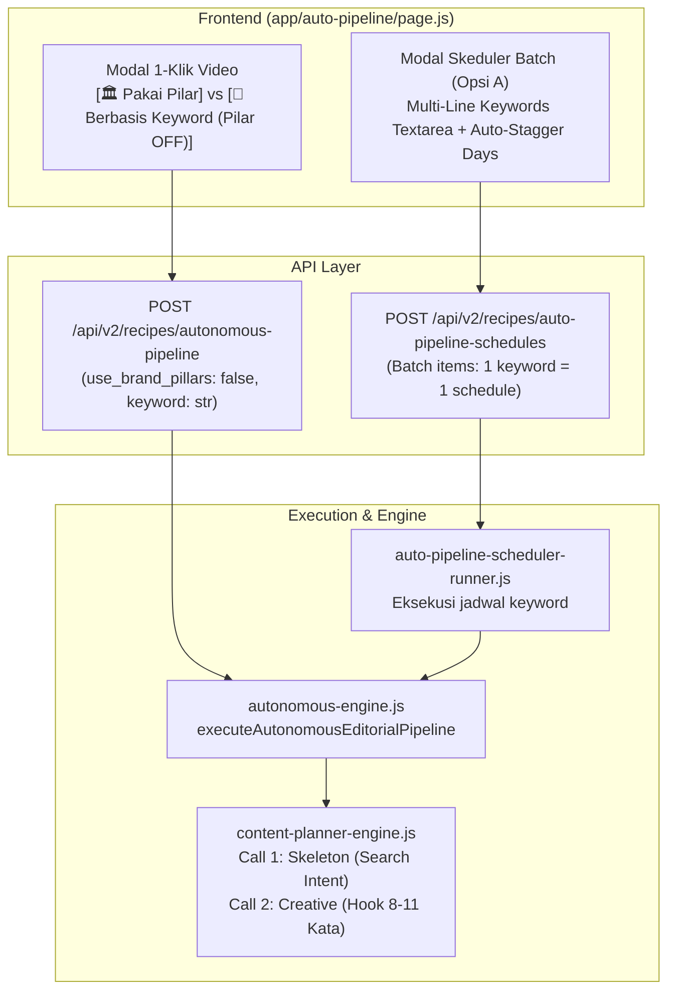

# Rencana Implementasi: Keyword-Based Video pada Brand Editorial (Opsi A — Batch Multi-Jadwal)

## 📌 Ringkasan Fitur
Fitur ini memungkinkan pengguna membuat video editorial berbasis **kata kunci target / search intent audiens** dengan menonaktifkan pilar brand bawaan (**Pilar OFF**). Fitur ini disematkan langsung pada modal **1-Klik Video (Instant Launch)** dan **Auto Pipeline Scheduler (Opsi A: Batch Multi-Jadwal)**.

---

## 🏗️ Arsitektur & Alur Data



---

## 📋 Execution Task List

- [ ] **Task 1: Content Planner Engine Prompt & Logic** — Update `lib/content-planner-engine.js` agar menghargai flag `use_brand_pillars: false` pada `brand_editorial` dan menyesuaikan prompt Call 1 (Skeleton) serta Call 2 (Creative) untuk keyword/search intent.
- [ ] **Task 2: Autonomous Engine Pipeline Parameter Binding** — Update `lib/autonomous-engine.js` (`executeAutonomousEditorialPipeline`) untuk menerima parameter `keyword` & `useBrandPillars` serta meneruskannya ke draf content planner.
- [ ] **Task 3: Autonomous Pipeline Route Parameter Binding** — Update `app/api/v2/recipes/autonomous-pipeline/route.js` untuk membaca `use_brand_pillars` dan `keyword` dari request body.
- [ ] **Task 4: Scheduler Runner Keyword Support** — Update `lib/auto-pipeline-scheduler-runner.js` agar membaca `use_brand_pillars` dan `keyword` dari `pipeline_config_json` pada saat jadwal dieksekusi.
- [ ] **Task 5: Frontend UI (Instant Launch Modal)** — Update `app/auto-pipeline/page.js` untuk menambahkan Segmented Control `[ 🏛️ Pakai Pilar Brand ]` vs `[ 🎯 Berbasis Keyword (Pilar OFF) ]`, input keyword, recommendation tags, dan live AI directive preview.
- [ ] **Task 6: Frontend UI (Batch Scheduler Modal Opsi A)** — Update `app/auto-pipeline/page.js` untuk menambahkan mode Multi-Keyword textarea, auto-stagger distribution checkbox, counter badge, live batch preview cards, dan payload batch creation ke API.
- [ ] **Task 7: Verifikasi End-to-End & Uji Coba** — Verifikasi eksekusi 1-klik keyword editorial dan batch schedule generation pada environment dev/staging.
- [ ] **Task 8: Rilis & Git Sync** — Jalankan `npm run release-non-interactive` dan deploy ke Dev & Staging sesuai SOP.

---

## 🔍 Before & After Code Snippets

### 1. `lib/content-planner-engine.js`

#### Code Sebelum (Current/Before):
```javascript
// Baris 273-274
  const normalizedUseBrandPillars = use_brand_pillars !== false && use_brand_pillars !== 'false' && use_brand_pillars !== 0 && use_brand_pillars !== '0';
  const shouldInheritBrandPillars = focus === 'brand_editorial' || normalizedUseBrandPillars;
```

#### Code Sesudah (Proposed/After):
```javascript
// Baris 273-274: Jangan paksa shouldInheritBrandPillars jika use_brand_pillars diset false eksplisit
  const normalizedUseBrandPillars = use_brand_pillars !== false && use_brand_pillars !== 'false' && use_brand_pillars !== 0 && use_brand_pillars !== '0';
  const shouldInheritBrandPillars = normalizedUseBrandPillars;
```

---

#### Call 1 (Skeleton Prompt) di `lib/content-planner-engine.js`

#### Code Sebelum (Current/Before):
```javascript
INSTRUKSI KHUSUS:
${focus === 'brand_editorial' ? `- MODE: BRAND EDITORIAL (BUKAN KAMPANYE PRODUK)
- Brand/Akun: ${activeBrandName}
- Konteks Brand: ${activeBrandContext}
- Tujuan Konten: ${activeContentGoal || 'Membangun authority dan engagement akun'}
- Pilar Wajib: ${pillars.join(', ')}
- Jumlah Pilar: ${pillars.length}
- Ide per Pilar: ${rowsPerPillar}
- Total Baris: ${count}
- Setiap pilar WAJIB muncul tepat ${rowsPerPillar} kali.
- DILARANG menambah, menghapus, mengganti nama, atau mengubah distribusi pilar dari Strategic Skeleton.
- DILARANG mengarang, menyimpulkan, atau memaksakan produk tertentu.
- Product reference harus null kecuali produk diberikan eksplisit.
- Fokus pada masalah, kebiasaan, sistem, bahan, teknik, dan lifestyle audiens.` : ...
```

#### Code Sesudah (Proposed/After):
```javascript
INSTRUKSI KHUSUS:
${focus === 'brand_editorial' ? `- MODE: BRAND EDITORIAL (BUKAN KAMPANYE PRODUK)
- Brand/Akun: ${activeBrandName}
- Konteks Brand: ${activeBrandContext}
- Tujuan Konten: ${activeContentGoal || 'Membangun authority dan engagement akun'}
${!normalizedUseBrandPillars ? `
🚨 PILAR MODE: KEYWORD / SEARCH INTENT DRIVEN (PILAR BRAND DINONAKTIFKAN / OFF)
- Pengguna memilih NON-AKTIFKAN pilar brand editorial dan memberikan kata kunci target: "${pillars.join(', ')}".
- Nilai field "pillar" pada output WAJIB menggunakan kata kunci target tersebut.
- AI WAJIB membedah search intent dari kata kunci tersebut (masalah umum pencarian audiens, mitos, miskonsepsi, trik praktis, atau solusi edukatif).
- Bangun storyline dan situasi kontekstual yang berakar pada kata kunci tersebut, dengan tetap mempertahankan tone of voice dan identitas brand.` : `
- Pilar Wajib: ${pillars.join(', ')}
- Jumlah Pilar: ${pillars.length}
- Ide per Pilar: ${rowsPerPillar}
- Total Baris: ${count}
- Setiap pilar WAJIB muncul tepat ${rowsPerPillar} kali.
- DILARANG menambah, menghapus, mengganti nama, atau mengubah distribusi pilar dari Strategic Skeleton.`}
- DILARANG mengarang, menyimpulkan, atau memaksakan produk tertentu.
- Product reference harus null kecuali produk diberikan eksplisit.
- Fokus pada masalah, kebiasaan, sistem, bahan, teknik, dan lifestyle audiens.` : ...
```

---

#### Call 2 (Creative Prompt) di `lib/content-planner-engine.js`

#### Code Sebelum (Current/Before):
```javascript
${focus === 'brand_editorial' ? `INFORMASI BRAND EDITORIAL:
- Akun: ${activeBrandName}
- Konteks & Filosofi Alur Berpikir: ${activeBrandContext}
- Tujuan Konten & Misi Literasi: ${activeContentGoal || 'Authority dan engagement'}
- Jangan mengarang produk atau membuat CTA pembelian.` : ...
```

#### Code Sesudah (Proposed/After):
```javascript
${focus === 'brand_editorial' ? `INFORMASI BRAND EDITORIAL:
- Akun: ${activeBrandName}
- Konteks & Filosofi Alur Berpikir: ${activeBrandContext}
- Tujuan Konten & Misi Literasi: ${activeContentGoal || 'Authority dan engagement'}
${!normalizedUseBrandPillars ? `- Topik Utama / Keyword Search Intent: "${pillars.join(', ')}" (Pilar brand OFF). Hook dan narasi wajib mengupas langsung masalah pencarian terkait topik/keyword ini secara lugas.` : ''}
- Jangan mengarang produk atau membuat CTA pembelian.` : ...
```

---

### 2. `lib/autonomous-engine.js`

#### Code Sebelum (Current/Before):
```javascript
export async function executeAutonomousEditorialPipeline({
  brandId,
  pillarTitle,
  presetKey = 'brand_editorial_campaign',
  tenantId = 'default_tenant',
  executionMode = 'full_autopilot',
  overrides = {}
}) {
  return tenantContext.run(tenantId || 'default_tenant', async () => {
  const db = getDb();
  const brand = brandId ? await db.prepare(
    'SELECT * FROM brand_profiles WHERE (id = ? OR brand_name = ?) AND (tenant_id = ? OR tenant_id IS NULL OR tenant_id = \'default_tenant\')'
  ).get(brandId, brandId, tenantId) : null;
  const brandName = brand?.brand_name || 'Brand';
  const effectivePillar = pillarTitle || 'Eat Better, Not Perfect';
  ...
  // 1. Create Draft Content Planner (Focus: brand_editorial)
  const plannerDraft = await createDraftContentPlanner({
    title: `${brandName} - Editorial: ${effectivePillar}`,
    account_name: brandName,
    brand_id: brand?.id || null,
    tenant_id: tenantId,
    planner_focus: 'brand_editorial',
    pillars: [effectivePillar],
    use_brand_pillars: true,
    target_language: effectiveTargetLanguage,
    target_audience: effectiveTargetAudience,
    brand_context: brand?.editorial_brand_context || '',
    content_goal: effectiveContentGoal,
    planner_count: 1
  });
```

#### Code Sesudah (Proposed/After):
```javascript
export async function executeAutonomousEditorialPipeline({
  brandId,
  pillarTitle,
  keyword = null,
  useBrandPillars = true,
  presetKey = 'brand_editorial_campaign',
  tenantId = 'default_tenant',
  executionMode = 'full_autopilot',
  overrides = {}
}) {
  return tenantContext.run(tenantId || 'default_tenant', async () => {
  const db = getDb();
  const brand = brandId ? await db.prepare(
    'SELECT * FROM brand_profiles WHERE (id = ? OR brand_name = ?) AND (tenant_id = ? OR tenant_id IS NULL OR tenant_id = \'default_tenant\')'
  ).get(brandId, brandId, tenantId) : null;
  const brandName = brand?.brand_name || 'Brand';

  const effectiveUseBrandPillars = overrides?.use_brand_pillars !== undefined 
    ? Boolean(overrides.use_brand_pillars)
    : (useBrandPillars !== false && !keyword && !overrides?.keyword);
  const effectiveKeyword = keyword || overrides?.keyword || (!effectiveUseBrandPillars ? pillarTitle : null);
  const effectivePillar = !effectiveUseBrandPillars && effectiveKeyword
    ? effectiveKeyword
    : (pillarTitle || 'Eat Better, Not Perfect');
  ...
  // 1. Create Draft Content Planner (Focus: brand_editorial)
  const plannerDraft = await createDraftContentPlanner({
    title: !effectiveUseBrandPillars
      ? `${brandName} - Keyword Editorial: ${effectivePillar}`
      : `${brandName} - Editorial: ${effectivePillar}`,
    account_name: brandName,
    brand_id: brand?.id || null,
    tenant_id: tenantId,
    planner_focus: 'brand_editorial',
    pillars: [effectivePillar],
    use_brand_pillars: effectiveUseBrandPillars,
    target_language: effectiveTargetLanguage,
    target_audience: effectiveTargetAudience,
    brand_context: brand?.editorial_brand_context || '',
    content_goal: effectiveContentGoal,
    planner_count: 1
  });
```

---

### 3. `app/api/v2/recipes/autonomous-pipeline/route.js`

#### Code Sebelum (Current/Before):
```javascript
    } else if (pipelineType === 'editorial_campaign') {
      result = await executeAutonomousEditorialPipeline({
        brandId: body.brand_id || body.brandId,
        pillarTitle: body.content_pillar || body.pillar_title || body.topic,
        presetKey: body.preset_key || body.presetKey || 'brand_editorial_campaign',
        executionMode: body.execution_mode || body.executionMode || 'full_autopilot',
        tenantId,
        overrides: {
          visual_identity_preset_id: body.visual_identity_preset_id || null,
          ...affiliateOverride,
          ...(body.overrides || {})
        }
      });
```

#### Code Sesudah (Proposed/After):
```javascript
    } else if (pipelineType === 'editorial_campaign') {
      const isKeywordMode = body.use_brand_pillars === false || Boolean(body.keyword);
      result = await executeAutonomousEditorialPipeline({
        brandId: body.brand_id || body.brandId,
        pillarTitle: body.content_pillar || body.pillar_title || body.topic,
        keyword: body.keyword || (isKeywordMode ? (body.content_pillar || body.pillar_title || body.topic) : null),
        useBrandPillars: body.use_brand_pillars !== undefined ? Boolean(body.use_brand_pillars) : !isKeywordMode,
        presetKey: body.preset_key || body.presetKey || 'brand_editorial_campaign',
        executionMode: body.execution_mode || body.executionMode || 'full_autopilot',
        tenantId,
        overrides: {
          visual_identity_preset_id: body.visual_identity_preset_id || null,
          use_brand_pillars: body.use_brand_pillars !== undefined ? Boolean(body.use_brand_pillars) : !isKeywordMode,
          keyword: body.keyword || (isKeywordMode ? (body.content_pillar || body.pillar_title || body.topic) : null),
          ...affiliateOverride,
          ...(body.overrides || {})
        }
      });
```

---

### 4. `lib/auto-pipeline-scheduler-runner.js`

#### Code Sebelum (Current/Before):
```javascript
  if (pType === 'editorial_campaign') {
    return await executeAutonomousEditorialPipeline({
      brandId: schedule.brand_id,
      pillarTitle: schedule.target_item_title || schedule.topic,
      presetKey: schedule.preset_key || 'brand_editorial_campaign',
      tenantId
    });
  }
```

#### Code Sesudah (Proposed/After):
```javascript
  if (pType === 'editorial_campaign') {
    const cfg = pipelineConfig;
    const isKeyword = cfg.use_brand_pillars === false || Boolean(cfg.keyword);
    return await executeAutonomousEditorialPipeline({
      brandId: schedule.brand_id,
      pillarTitle: schedule.target_item_title || schedule.topic,
      keyword: cfg.keyword || (isKeyword ? (schedule.target_item_title || schedule.topic) : null),
      useBrandPillars: cfg.use_brand_pillars !== false,
      presetKey: schedule.preset_key || 'brand_editorial_campaign',
      tenantId,
      overrides: {
        ...(cfg || {})
      }
    });
  }
```

---

### 5. `app/auto-pipeline/page.js`

#### Code Sebelum (Current/Before) — Instant Editorial Section:
```jsx
{/* 3B: VIDEO EDITORIAL (Pilar Brand Selector) */}
{instantCampaignType === 'editorial_campaign' && (
  <div style={{ ... }}>
    <div style={{ display: 'flex', justifyContent: 'space-between', alignItems: 'center' }}>
      <div style={{ fontSize: '0.88rem', fontWeight: 800 }}>Pilih Pilar Konten Brand:</div>
      ...
    </div>
    {/* Search box & Pillars Grid */}
```

#### Code Sesudah (Proposed/After) — Instant Editorial Section:
```jsx
{/* 3B: VIDEO EDITORIAL (Segmented Control: Pilar vs Keyword) */}
{instantCampaignType === 'editorial_campaign' && (
  <div style={{
    background: 'var(--surface-raised)',
    border: '1.5px solid var(--border-strong)',
    borderRadius: 'var(--radius-md)',
    padding: '1.15rem',
    display: 'flex',
    flexDirection: 'column',
    gap: '0.85rem'
  }}>
    <div style={{ display: 'flex', justifyContent: 'space-between', alignItems: 'center', flexWrap: 'wrap', gap: '0.5rem' }}>
      <div style={{ fontSize: '0.88rem', fontWeight: 800, color: 'var(--text-primary)', display: 'flex', alignItems: 'center', gap: '0.45rem' }}>
        <span>📖</span>
        <span>Konfigurasi Topik Editorial:</span>
      </div>
      
      {/* Segmented Control */}
      <div style={{ display: 'flex', background: 'var(--surface)', padding: '0.25rem', borderRadius: 'var(--radius-sm)', border: '1px solid var(--border-subtle)', gap: '0.25rem' }}>
        <button
          type="button"
          onClick={() => setInstantEditorialMode('pillar')}
          style={{
            padding: '0.35rem 0.75rem',
            border: 'none',
            borderRadius: 'var(--radius-xs)',
            fontSize: '0.78rem',
            fontWeight: 700,
            cursor: 'pointer',
            background: instantEditorialMode === 'pillar' ? 'var(--status-info)' : 'transparent',
            color: instantEditorialMode === 'pillar' ? '#ffffff' : 'var(--text-muted)'
          }}
        >
          🏛️ Pakai Pilar Brand
        </button>
        <button
          type="button"
          onClick={() => setInstantEditorialMode('keyword')}
          style={{
            padding: '0.35rem 0.75rem',
            border: 'none',
            borderRadius: 'var(--radius-xs)',
            fontSize: '0.78rem',
            fontWeight: 700,
            cursor: 'pointer',
            background: instantEditorialMode === 'keyword' ? 'var(--status-info)' : 'transparent',
            color: instantEditorialMode === 'keyword' ? '#ffffff' : 'var(--text-muted)'
          }}
        >
          🎯 Berbasis Keyword (Pilar OFF)
        </button>
      </div>
    </div>

    {instantEditorialMode === 'pillar' ? (
      <>
        {/* Search box & Scrollable Pillars List */}
      </>
    ) : (
      <div style={{ display: 'flex', flexDirection: 'column', gap: '0.75rem' }}>
        <div style={{ display: 'flex', justifyContent: 'space-between', alignItems: 'center' }}>
          <span style={{ fontSize: '0.8rem', color: 'var(--text-muted)' }}>
            Masukkan kata kunci atau topik pencarian audiens (Pilar brand dinonaktifkan):
          </span>
          <span style={{ fontSize: '0.72rem', fontWeight: 700, background: 'var(--status-warning-soft)', color: 'var(--status-warning)', padding: '0.15rem 0.5rem', borderRadius: 9999 }}>
            Pilar Brand: OFF ⚠️
          </span>
        </div>
        <input
          type="text"
          value={instantEditorialKeyword}
          onChange={(e) => setInstantEditorialKeyword(e.target.value)}
          placeholder="Contoh: peredam suara studio podcast murah, cara hilangkan dengung kamar"
          style={{
            width: '100%',
            height: '38px',
            background: 'var(--surface)',
            border: '1px solid var(--border-subtle)',
            borderRadius: 'var(--radius-sm)',
            padding: '0 10px',
            color: 'var(--text-primary)',
            fontSize: '0.84rem',
            outline: 'none'
          }}
        />
        <div style={{ fontSize: '0.74rem', color: 'var(--text-secondary)', background: 'var(--surface-interactive)', padding: '0.55rem 0.75rem', borderRadius: 'var(--radius-xs)', border: '1px solid var(--border-subtle)' }}>
          🤖 <strong>Arahan Gemini AI 1-Pass:</strong> AI akan membedah search intent dari keyword ini menjadi narasi storytelling tension berdurasi 30-45 detik dengan formula Hook 8-11 kata.
        </div>
      </div>
    )}
```

---

#### Code Sebelum (Current/Before) — Scheduler Editorial Section:
```jsx
{/* 3B. EDITORIAL: Multi-Select Pilar Konten Brand */}
{schedCampaignType === 'editorial_campaign' && (
  <div style={{ ... }}>
    <div style={{ display: 'flex', justifyContent: 'space-between', alignItems: 'center' }}>
      <div style={{ fontSize: '0.85rem', fontWeight: 800 }}>Pilih Pilar Konten Brand:</div>
      ...
    </div>
    {/* Search & Pillars list */}
```

#### Code Sesudah (Proposed/After) — Scheduler Editorial Section (Opsi A Batch):
```jsx
{/* 3B. EDITORIAL: Segmented Control & Multi-Keyword Textarea */}
{schedCampaignType === 'editorial_campaign' && (
  <div style={{
    background: 'var(--surface-raised)',
    border: '1.5px solid var(--border-strong)',
    borderRadius: 'var(--radius-md)',
    padding: '1rem',
    display: 'flex',
    flexDirection: 'column',
    gap: '0.75rem'
  }}>
    <div style={{ display: 'flex', justifyContent: 'space-between', alignItems: 'center', flexWrap: 'wrap', gap: '0.5rem' }}>
      <div style={{ fontSize: '0.85rem', fontWeight: 800, color: 'var(--text-primary)', display: 'flex', alignItems: 'center', gap: '0.45rem' }}>
        <span>📅</span>
        <span>Mode Sumber Topik Penjadwalan:</span>
      </div>
      <div style={{ display: 'flex', background: 'var(--surface)', padding: '0.25rem', borderRadius: 'var(--radius-sm)', border: '1px solid var(--border-subtle)', gap: '0.25rem' }}>
        <button
          type="button"
          onClick={() => setSchedEditorialMode('pillar')}
          style={{
            padding: '0.35rem 0.75rem',
            border: 'none',
            borderRadius: 'var(--radius-xs)',
            fontSize: '0.78rem',
            fontWeight: 700,
            cursor: 'pointer',
            background: schedEditorialMode === 'pillar' ? 'var(--status-info)' : 'transparent',
            color: schedEditorialMode === 'pillar' ? '#ffffff' : 'var(--text-muted)'
          }}
        >
          🏛️ Multi-Pilar Brand
        </button>
        <button
          type="button"
          onClick={() => setSchedEditorialMode('keyword')}
          style={{
            padding: '0.35rem 0.75rem',
            border: 'none',
            borderRadius: 'var(--radius-xs)',
            fontSize: '0.78rem',
            fontWeight: 700,
            cursor: 'pointer',
            background: schedEditorialMode === 'keyword' ? 'var(--status-info)' : 'transparent',
            color: schedEditorialMode === 'keyword' ? '#ffffff' : 'var(--text-muted)'
          }}
        >
          🎯 Multi-Keyword (Pilar OFF)
        </button>
      </div>
    </div>

    {schedEditorialMode === 'pillar' ? (
      <>
        {/* Existing Multi-Pillar Selector */}
      </>
    ) : (
      <div style={{ display: 'flex', flexDirection: 'column', gap: '0.75rem' }}>
        <div style={{ display: 'flex', justifyContent: 'space-between', alignItems: 'center' }}>
          <label style={{ fontSize: '0.82rem', fontWeight: 700, color: 'var(--text-secondary)' }}>
            Daftar Kata Kunci (1 baris = 1 jadwal mandiri):
          </label>
          <span style={{ fontSize: '0.74rem', fontWeight: 700, background: 'var(--status-info-soft)', color: 'var(--status-info)', padding: '0.15rem 0.55rem', borderRadius: 9999 }}>
            {schedEditorialKeywordsText.split('\n').filter(k => k.trim()).length} Kata Kunci
          </span>
        </div>
        <textarea
          rows={4}
          value={schedEditorialKeywordsText}
          onChange={(e) => setSchedEditorialKeywordsText(e.target.value)}
          placeholder={'peredam suara studio podcast murah\ncara hilangkan dengung kamar tidur\nperbedaan rockwool vs glasswool untuk studio'}
          style={{
            width: '100%',
            background: 'var(--surface)',
            border: '1px solid var(--border-subtle)',
            borderRadius: 'var(--radius-sm)',
            padding: '0.65rem',
            color: 'var(--text-primary)',
            fontSize: '0.82rem',
            fontFamily: 'var(--font-mono)',
            outline: 'none',
            resize: 'vertical'
          }}
        />
        <div style={{ display: 'flex', alignItems: 'center', gap: '0.5rem' }}>
          <input
            type="checkbox"
            id="chkSchedStagger"
            checked={schedStaggerDays}
            onChange={(e) => setSchedStaggerDays(e.target.checked)}
            style={{ accentColor: 'var(--action-primary)', cursor: 'pointer' }}
          />
          <label htmlFor="chkSchedStagger" style={{ fontSize: '0.8rem', color: 'var(--text-primary)', cursor: 'pointer' }}>
            <strong>Distribusi Hari Otomatis:</strong> Sebarkan setiap kata kunci ke hari yang berurutan (Senin, Selasa, Rabu, dst).
          </label>
        </div>
      </div>
    )}
```

---

## 🎯 Verifikasi & Rilis
1. Uji 1-Klik Video Editorial dengan mode keyword pada dev.
2. Uji pembuatan jadwal batch keyword pada dev (`POST /api/v2/recipes/auto-pipeline-schedules`).
3. Uji trigger jadwal manual untuk memastikan video ter-generate dengan search intent keyword.
4. Rilis non-interaktif `npm run release-non-interactive` dan deploy atomic ke Staging & Dev.

