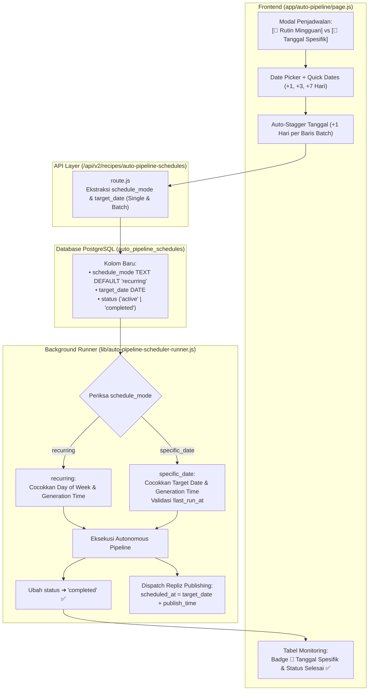

# Rencana Implementasi: Penjadwalan Berbasis Tanggal & Jam (Calendar Date Scheduling)

## 📌 Ringkasan Fitur
Fitur ini memperluas sistem penjadwalan pada **Auto Pipeline Scheduler** dari yang sebelumnya hanya berbasis **Hari Rutin Mingguan (`days_of_week`)** menjadi mendukung **Tanggal Kalender Spesifik (`target_date`) & Jam (`generation_time`)**. 

*(Catatan: Rencana ekspansi Universal Batch untuk seluruh jenis video telah dipisahkan ke dokumen tersendiri: [`docs/rencana_universal_batch.md`](file:///Users/sabeqmmursyid/_cfstudio/docs/rencana_universal_batch.md) dan akan dieksekusi pada iterasi berikutnya).*

### 🎯 2 Mode Penjadwalan (Dual Scheduling Modes):
1. **Mode 🔄 Rutin Mingguan (`schedule_mode: 'recurring'`) — *Default / Eksisting***:
   - Mengeksekusi pipeline berulang setiap minggu pada hari-hari yang dipilih (`days_of_week`) pada jam yang ditentukan.
   - Status jadwal tetap `active` secara berkelanjutan.
2. **Mode 📅 Tanggal Spesifik (`schedule_mode: 'specific_date'`) — *Fitur Baru***:
   - Mengeksekusi pipeline tepat pada tanggal kalender tertentu (`target_date`) pada jam yang ditentukan.
   - Bersifat *One-Time Execution*: setelah video berhasil diproduksi dan diserahkan ke sistem publikasi Repliz, status jadwal otomatis diperbarui menjadi `completed` agar tidak dieksekusi berulang di masa mendatang.
   - Dilengkapi dukungan **Auto-Stagger Tanggal (+1 Hari)** pada jadwal batch eksisting (seperti Editorial Keyword Opsi A & Multi-Produk Katalog).

---

## 🏗️ Arsitektur & Alur Data



---

## 📋 Execution Task List

- [x] **Task 1: DDL Database Migration** — Update `lib/db-pg.js` untuk menambahkan kolom `schedule_mode TEXT NOT NULL DEFAULT 'recurring'`, kolom `target_date DATE`, serta indeks performa pada tabel `auto_pipeline_schedules`.
- [x] **Task 2: Repository Data Access Layer** — Update `lib/auto-pipeline-schedules-repository.js` untuk memetakan `schedule_mode` dan `target_date` pada `createAutoPipelineSchedule`, `updateAutoPipelineSchedule`, `normalizeScheduleRow`, dan `createAutoPipelineScheduleBatch`.
- [x] **Task 3: Background Scheduler Runner Logic** — Update `lib/auto-pipeline-scheduler-runner.js` (`runDueAutoPipelineGenerations` & `computeTargetPublishIso`) untuk mengevaluasi kesesuaian tanggal kalender, mencegah eksekusi ulang jadwal yang telah berjalan, mengupdate status jadwal `specific_date` menjadi `'completed'`, dan menyelaraskan waktu publikasi Repliz.
- [x] **Task 4: API Endpoint Parameter Binding** — Update `app/api/v2/recipes/auto-pipeline-schedules/route.js` untuk membaca dan memvalidasi `schedule_mode` dan `target_date` pada endpoint single schedule maupun batch payload (`body.items`).
- [x] **Task 5: Frontend UI Modal Skeduler (Segmented Control & Date Picker)** — Update `app/auto-pipeline/page.js` untuk menambahkan Segmented Control `[ 🔄 Rutin Mingguan ]` vs `[ 📅 Tanggal Spesifik ]`, input Date Picker `<input type="date">`, tombol Quick Date Presets (`[Hari Ini]`, `[Besok]`, `[+3 Hari]`, `[+7 Hari]`), dan auto-stagger tanggal kalender untuk batch keyword/produk dengan 100% Semantic CSS Tokens.
- [x] **Task 6: Frontend UI Tabel Monitoring & Filter Dual-Mode** — Update tabel monitoring jadwal di `app/auto-pipeline/page.js` untuk menampilkan format tanggal spesifik `📅 YYYY-MM-DD`, badge status `Selesai ✅`, dan filter mode jadwal.
- [x] **Task 7: Verifikasi End-to-End & Uji Coba** — Uji pembuatan jadwal tanggal spesifik, eksekusi runner, auto-completion status, serta auto-stagger batch kalender pada environment Dev/Staging.
- [x] **Task 8: Rilis & Git Sync** — Jalankan `npm run release-non-interactive` dan deploy atomic ke Staging & Dev Mac Mini sesuai SOP.

---

## 🔍 Before & After Code Snippets

### 1. `lib/db-pg.js` (DDL Migration)

#### Code Sebelum (Current/Before):
```javascript
// Baris 1695-1708
          ALTER TABLE auto_pipeline_schedules ADD COLUMN IF NOT EXISTS pipeline_type TEXT NOT NULL DEFAULT 'recipe_campaign';
          ALTER TABLE auto_pipeline_schedules ADD COLUMN IF NOT EXISTS target_item_id TEXT;
          ALTER TABLE auto_pipeline_schedules ADD COLUMN IF NOT EXISTS target_item_title TEXT;
          ALTER TABLE auto_pipeline_schedules ADD COLUMN IF NOT EXISTS pipeline_config_json JSONB NOT NULL DEFAULT '{}';

          CREATE INDEX IF NOT EXISTS auto_pipeline_schedules_tenant_status_idx 
            ON auto_pipeline_schedules(tenant_id, status);
          CREATE INDEX IF NOT EXISTS auto_pipeline_schedules_brand_idx 
            ON auto_pipeline_schedules(tenant_id, brand_id);
          CREATE INDEX IF NOT EXISTS auto_pipeline_schedules_type_idx 
            ON auto_pipeline_schedules(tenant_id, pipeline_type);
```

#### Code Sesudah (Proposed/After):
```javascript
// Baris 1695-1715: Penambahan kolom schedule_mode dan target_date
          ALTER TABLE auto_pipeline_schedules ADD COLUMN IF NOT EXISTS pipeline_type TEXT NOT NULL DEFAULT 'recipe_campaign';
          ALTER TABLE auto_pipeline_schedules ADD COLUMN IF NOT EXISTS target_item_id TEXT;
          ALTER TABLE auto_pipeline_schedules ADD COLUMN IF NOT EXISTS target_item_title TEXT;
          ALTER TABLE auto_pipeline_schedules ADD COLUMN IF NOT EXISTS pipeline_config_json JSONB NOT NULL DEFAULT '{}';
          ALTER TABLE auto_pipeline_schedules ADD COLUMN IF NOT EXISTS schedule_mode TEXT NOT NULL DEFAULT 'recurring';
          ALTER TABLE auto_pipeline_schedules ADD COLUMN IF NOT EXISTS target_date DATE;

          CREATE INDEX IF NOT EXISTS auto_pipeline_schedules_tenant_status_idx 
            ON auto_pipeline_schedules(tenant_id, status);
          CREATE INDEX IF NOT EXISTS auto_pipeline_schedules_brand_idx 
            ON auto_pipeline_schedules(tenant_id, brand_id);
          CREATE INDEX IF NOT EXISTS auto_pipeline_schedules_type_idx 
            ON auto_pipeline_schedules(tenant_id, pipeline_type);
          CREATE INDEX IF NOT EXISTS auto_pipeline_schedules_mode_idx 
            ON auto_pipeline_schedules(tenant_id, schedule_mode, status);
```

---

### 2. `lib/auto-pipeline-schedules-repository.js`

#### Code Sebelum (Current/Before) — `createAutoPipelineSchedule`:
```javascript
// Baris 140-161
  const timezone = data.timezone || 'Asia/Jakarta';
  const replizAccountIds = Array.isArray(data.repliz_account_ids) ? data.repliz_account_ids : [];
  const pipelineConfig = data.pipeline_config_json || data.pipeline_config || {};
  const autoPublishEnabled = data.auto_publish_enabled !== false;
  const status = data.status || 'active';

  const sql = `
    INSERT INTO auto_pipeline_schedules (
      id, tenant_id, pipeline_type, name, brand_id, preset_key,
      target_item_id, target_item_title, topic_strategy, topic,
      category, recipe_count, generation_time, publish_time, days_of_week_json,
      timezone, repliz_account_ids_json, pipeline_config_json, auto_publish_enabled, status,
      created_at, updated_at
    ) VALUES (
      $1, $2, $3, $4, $5, $6,
      $7, $8, $9, $10,
      $11, $12, $13, $14, $15,
      $16, $17, $18, $19, $20,
      CURRENT_TIMESTAMP, CURRENT_TIMESTAMP
    )
    RETURNING *
  `;
```

#### Code Sesudah (Proposed/After) — `createAutoPipelineSchedule`:
```javascript
// Baris 140-170: Dukungan schedule_mode & target_date
  const timezone = data.timezone || 'Asia/Jakarta';
  const replizAccountIds = Array.isArray(data.repliz_account_ids) ? data.repliz_account_ids : [];
  const pipelineConfig = data.pipeline_config_json || data.pipeline_config || {};
  const autoPublishEnabled = data.auto_publish_enabled !== false;
  const status = data.status || 'active';
  const scheduleMode = data.schedule_mode || 'recurring';
  const targetDate = data.target_date || null;

  const sql = `
    INSERT INTO auto_pipeline_schedules (
      id, tenant_id, pipeline_type, name, brand_id, preset_key,
      target_item_id, target_item_title, topic_strategy, topic,
      category, recipe_count, generation_time, publish_time, days_of_week_json,
      timezone, repliz_account_ids_json, pipeline_config_json, auto_publish_enabled, status,
      schedule_mode, target_date,
      created_at, updated_at
    ) VALUES (
      $1, $2, $3, $4, $5, $6,
      $7, $8, $9, $10,
      $11, $12, $13, $14, $15,
      $16, $17, $18, $19, $20,
      $21, $22,
      CURRENT_TIMESTAMP, CURRENT_TIMESTAMP
    )
    RETURNING *
  `;
```

---

#### Code Sebelum (Current/Before) — `normalizeScheduleRow`:
```javascript
// Baris 401-408
  return {
    ...row,
    pipeline_type: row.pipeline_type || 'recipe_campaign',
    pipeline_config: pipelineConfig,
    days_of_week: daysOfWeek,
    repliz_account_ids: replizAccountIds
  };
```

#### Code Sesudah (Proposed/After) — `normalizeScheduleRow`:
```javascript
// Baris 401-412
  let targetDateNormalized = null;
  if (row.target_date) {
    targetDateNormalized = typeof row.target_date === 'string'
      ? row.target_date.slice(0, 10)
      : new Date(row.target_date).toISOString().slice(0, 10);
  }

  return {
    ...row,
    pipeline_type: row.pipeline_type || 'recipe_campaign',
    schedule_mode: row.schedule_mode || 'recurring',
    target_date: targetDateNormalized,
    pipeline_config: pipelineConfig,
    days_of_week: daysOfWeek,
    repliz_account_ids: replizAccountIds
  };
```

---

### 3. `lib/auto-pipeline-scheduler-runner.js`

#### Code Sebelum (Current/Before) — `computeTargetPublishIso`:
```javascript
// Baris 56-81
function computeTargetPublishIso(publishTimeStr = '09:00', timeZone = 'Asia/Jakarta') {
  const now = new Date();
  const [targetH, targetM] = publishTimeStr.split(':').map(Number);

  // Cari tanggal hari ini di timezone tersebut
  const formatter = new Intl.DateTimeFormat('en-CA', {
    timeZone,
    year: 'numeric',
    month: '2-digit',
    day: '2-digit',
    hour12: false
  });
  const todayStr = formatter.format(now); // YYYY-MM-DD

  // Format ISO local string
  const hPad = String(targetH).padStart(2, '0');
  const mPad = String(targetM).padStart(2, '0');
  const targetDateLocal = new Date(`${todayStr}T${hPad}:${mPad}:00+07:00`);

  // Jika waktu target hari ini sudah terlewat lebih dari 15 menit yang lalu, jadwalkan 15 menit dari sekarang
  if (targetDateLocal.getTime() <= now.getTime()) {
    return new Date(now.getTime() + 15 * 60 * 1000).toISOString();
  }

  return targetDateLocal.toISOString();
}
```

#### Code Sesudah (Proposed/After) — `computeTargetPublishIso`:
```javascript
// Baris 56-85: Mendukung targetDateStr spesifik
function computeTargetPublishIso(publishTimeStr = '09:00', timeZone = 'Asia/Jakarta', targetDateStr = null) {
  const now = new Date();
  const [targetH, targetM] = publishTimeStr.split(':').map(Number);

  let dateBase = targetDateStr;
  if (!dateBase) {
    const formatter = new Intl.DateTimeFormat('en-CA', {
      timeZone,
      year: 'numeric',
      month: '2-digit',
      day: '2-digit',
      hour12: false
    });
    dateBase = formatter.format(now); // YYYY-MM-DD
  }

  const hPad = String(targetH).padStart(2, '0');
  const mPad = String(targetM).padStart(2, '0');
  const targetDateLocal = new Date(`${dateBase}T${hPad}:${mPad}:00+07:00`);

  if (targetDateLocal.getTime() <= now.getTime()) {
    return new Date(now.getTime() + 15 * 60 * 1000).toISOString();
  }

  return targetDateLocal.toISOString();
}
```

---

#### Code Sebelum (Current/Before) — `runDueAutoPipelineGenerations`:
```javascript
// Baris 195-212
  for (const row of schedulesRes.rows) {
    const tz = row.timezone || 'Asia/Jakarta';
    const { dateStr, timeStr, dayOfWeek } = getNowInTimezone(tz);

    // Cek days of week
    let daysOfWeek = [0, 1, 2, 3, 4, 5, 6];
    if (row.days_of_week_json) {
      daysOfWeek = typeof row.days_of_week_json === 'string'
        ? JSON.parse(row.days_of_week_json)
        : row.days_of_week_json;
    }
    if (!daysOfWeek.includes(dayOfWeek)) continue;

    // Cek apakah waktu saat ini cocok dengan generation_time
    const targetGenTime = row.generation_time || '05:00';
    if (timeStr !== targetGenTime) continue;
```

#### Code Sesudah (Proposed/After) — `runDueAutoPipelineGenerations`:
```javascript
// Baris 195-230: Evaluasi schedule_mode recurring vs specific_date & auto-completion
  for (const row of schedulesRes.rows) {
    const tz = row.timezone || 'Asia/Jakarta';
    const { dateStr, timeStr, dayOfWeek } = getNowInTimezone(tz);
    const schedMode = row.schedule_mode || 'recurring';

    if (schedMode === 'specific_date') {
      const rowTargetDate = row.target_date ? String(row.target_date).slice(0, 10) : null;
      if (!rowTargetDate || dateStr !== rowTargetDate) continue;
      if (row.last_run_at) continue; // Jangan ulangi jadwal specific_date yang sudah pernah jalan
    } else {
      let daysOfWeek = [0, 1, 2, 3, 4, 5, 6];
      if (row.days_of_week_json) {
        daysOfWeek = typeof row.days_of_week_json === 'string'
          ? JSON.parse(row.days_of_week_json)
          : row.days_of_week_json;
      }
      if (!daysOfWeek.includes(dayOfWeek)) continue;
    }

    const targetGenTime = row.generation_time || '05:00';
    if (timeStr !== targetGenTime) continue;
```
*(Serta di akhir eksekusi berhasil, jika `schedMode === 'specific_date'`, jalankan query `UPDATE auto_pipeline_schedules SET status = 'completed'`)*.

---

### 4. `app/api/v2/recipes/auto-pipeline-schedules/route.js`

#### Code Sebelum (Current/Before):
```javascript
// Baris 59-62 & 95-98
          pipeline_config_json: item.pipeline_config_json || item.pipeline_config || {},
          auto_publish_enabled: item.auto_publish_enabled !== false,
          status: item.status || 'active'
```

#### Code Sesudah (Proposed/After):
```javascript
// Ekstraksi schedule_mode dan target_date untuk batch dan single
          schedule_mode: item.schedule_mode || 'recurring',
          target_date: item.target_date || null,
          pipeline_config_json: item.pipeline_config_json || item.pipeline_config || {},
          auto_publish_enabled: item.auto_publish_enabled !== false,
          status: item.status || 'active'
```

---

### 5. `app/auto-pipeline/page.js` (Frontend UI)

#### Code Sebelum (Current/Before) — Konfigurasi Hari Rutin di Modal:
```jsx
// Baris 6730-6734
                <div style={{ display: 'flex', flexDirection: 'column', gap: '0.35rem' }}>
                  <label style={{ fontSize: '0.82rem', fontWeight: 700, color: 'var(--text-secondary)' }}>
                    Hari Rutin Eksekusi:
                  </label>
                  <div style={{ display: 'flex', gap: '0.45rem', flexWrap: 'wrap' }}>
```

#### Code Sesudah (Proposed/After) — Segmented Control Mode & Date Picker:
```jsx
// Baris 6730+: Segmented Control Rutin vs Tanggal Spesifik (100% Semantic Tokens)
                <div style={{ display: 'flex', flexDirection: 'column', gap: '0.65rem' }}>
                  <div style={{ display: 'flex', justifyContent: 'space-between', alignItems: 'center', flexWrap: 'wrap', gap: '0.5rem' }}>
                    <label style={{ fontSize: '0.82rem', fontWeight: 700, color: 'var(--text-secondary)' }}>
                      Mode Waktu Eksekusi:
                    </label>
                    <div style={{ display: 'flex', background: 'var(--surface)', padding: '0.2rem', borderRadius: 'var(--radius-sm)', border: '1px solid var(--border-subtle)', gap: '0.25rem' }}>
                      <button
                        type="button"
                        onClick={() => setSchedMode('recurring')}
                        style={{
                          padding: '0.35rem 0.75rem',
                          border: 'none',
                          borderRadius: 'var(--radius-xs)',
                          fontSize: '0.78rem',
                          fontWeight: 700,
                          cursor: 'pointer',
                          background: schedMode === 'recurring' ? 'var(--status-info)' : 'transparent',
                          color: schedMode === 'recurring' ? 'var(--on-action-primary)' : 'var(--text-muted)',
                          transition: 'var(--transition)'
                        }}
                      >
                        🔄 Rutin Mingguan
                      </button>
                      <button
                        type="button"
                        onClick={() => setSchedMode('specific_date')}
                        style={{
                          padding: '0.35rem 0.75rem',
                          border: 'none',
                          borderRadius: 'var(--radius-xs)',
                          fontSize: '0.78rem',
                          fontWeight: 700,
                          cursor: 'pointer',
                          background: schedMode === 'specific_date' ? 'var(--status-info)' : 'transparent',
                          color: schedMode === 'specific_date' ? 'var(--on-action-primary)' : 'var(--text-muted)',
                          transition: 'var(--transition)'
                        }}
                      >
                        📅 Tanggal Spesifik
                      </button>
                    </div>
                  </div>

                  {schedMode === 'recurring' ? (
                    <div style={{ display: 'flex', gap: '0.45rem', flexWrap: 'wrap' }}>
                      {/* Hari Sen - Min */}
                    </div>
                  ) : (
                    <div style={{ display: 'flex', flexDirection: 'column', gap: '0.5rem' }}>
                      <div style={{ display: 'flex', gap: '0.5rem', alignItems: 'center', flexWrap: 'wrap' }}>
                        <input
                          type="date"
                          value={schedTargetDate}
                          onChange={(e) => setSchedTargetDate(e.target.value)}
                          style={{
                            height: '38px',
                            background: 'var(--input-bg)',
                            border: '1px solid var(--border-subtle)',
                            borderRadius: 'var(--radius-sm)',
                            padding: '0 0.75rem',
                            fontSize: '0.84rem',
                            color: 'var(--text-primary)',
                            fontWeight: 700
                          }}
                        />
                        {/* Quick date buttons: Hari Ini, Besok, +3 Hari, +7 Hari */}
                      </div>
                      <span style={{ fontSize: '0.74rem', color: 'var(--text-muted)' }}>
                        💡 Pipeline akan dieksekusi 1 kali pada tanggal ini. Setelah selesai, status otomatis menjadi <strong>Selesai (Completed)</strong>.
                      </span>
                    </div>
                  )}
                </div>
```

---

## 🎯 Rencana Verifikasi & Uji Coba

1. **Uji DDL Migration**: Pastikan kolom `schedule_mode` dan `target_date` terbuat tanpa error di database dev/staging.
2. **Uji UI Modal**: Periksa pergantian mode *Rutin Mingguan* vs *Tanggal Spesifik* serta quick date pill pada kedua tema (Light & Dark).
3. **Uji Auto-Stagger Kalender**: Masukkan 5 kata kunci editorial (Opsi A) dengan tanggal mulai `2026-11-15`, pastikan 5 jadwal terbentuk berurutan dari tanggal 15 s/d 19.
4. **Uji Eksekusi Runner**: Simulasikan eksekusi jadwal tanggal spesifik hari ini dan pastikan status jadwal berubah menjadi `'completed'`.
5. **Uji Repliz Dispatch**: Pastikan payload publikasi ke Repliz mematuhi `target_date` + `publish_time`.
6. **Rilis & Deployment**: Jalankan rilis non-interaktif dan deploy atomic ke Dev & Staging Mac Mini sesuai SOP.

